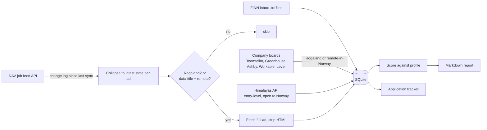

# jobradar-norway

A small data pipeline that finds and ranks data jobs in Rogaland, plus remote roles open to people in Norway. It combines NAV's official job vacancy feed, FINN.no's job search (with FINN's permission), company career boards and the Himalayas remote job API.

I built it for my own job search as a final-year applied data science student, and as a practical exercise in working with a real API, cleaning messy text and building an explainable scoring model.

## What it does



- **Sync**: reads [NAV's job vacancy feed](https://navikt.github.io/pam-stilling-feed/) incrementally. The feed is a change log, so the latest item per ad decides its status. Ads that become inactive are deleted, as NAV's terms of use require.
- **Filter**: every Rogaland ad is kept; ads elsewhere are kept only if the title looks data-related and the text says the role is fully remote.
- **Company boards**: reads the public job feeds of the applicant tracking systems that companies use (configured in [sources.yaml](sources.yaml)). Each sync is a full snapshot, so closed jobs disappear.
- **Remote**: searches the [Himalayas](https://himalayas.app) remote jobs API for entry-level data roles open to people in Norway. Because job boards sometimes get locations wrong, each job is checked against the company's own posting (Lever, Greenhouse, Ashby or Workable) when it can be found; jobs whose posting is limited to other countries are dropped, and the rest are marked *verified* or *unverified*.
- **Score**: each ad gets a 0-100 score that is easy to explain (see below).
- **Report**: writes `reports/jobs-YYYY-MM-DD.md` with separate Rogaland and remote tables, the skills each ad matched, warning flags, and which CV to send (Norwegian or English, from the ad's language).
- **Track**: `jobradar mark <id> applied` keeps a simple record of each application's status.

On a 14-day window (Nov 2026) the sync scanned ~12,400 feed items, of which ~5,700 ads were active and ~480 were in Rogaland or remote.

## Scoring model

| Component | Weight | How |
|---|---:|---|
| Skill coverage | 45 | share of profile skills mentioned in the ad (word-boundary matching, Norwegian + English aliases) |
| Text similarity | 25 | TF-IDF (1-2 grams) cosine similarity between profile and ad, fitted on the whole batch |
| Role fit | +15 | data/analytics wording in the title |
| Entry level | +15 | junior, graduate, trainee, nyutdannet, internship... |
| Senior title | -30 | senior, lead, manager, leder... |
| Academic post | -30 | PhD, stipendiat, researcher... |
| Experience ask | -15 | "3+ års erfaring" / "5 years of experience" or more |
| Other language | -25 | requires a language not listed in the profile (e.g. "fluent German") |

It's deliberately rule-based so every score can be explained. A next step is to label ~200 ads as relevant/not and train a classifier to compare against these rules (see Roadmap).

## Data sources and terms

| Source | Access | Notes |
|---|---|---|
| NAV job vacancy feed | Official API, free token | Inactive ads are deleted, as the terms require |
| Company boards | Public ATS job feeds | Every request is checked against robots.txt first |
| LinkedIn | Your job alert emails only | LinkedIn forbids scraping, so linkedin.com is never opened. `jobradar linkedin` reads LinkedIn's alert and recommendation emails in Mail.app |
| Himalayas | Public API | Credited in reports; applications go through its `applicationLink` |
| FINN.no | Job search, with written permission | FINN's terms forbid automated use without consent; FINN allowed it for a personal, non-commercial job search. Only job search and ad pages, 3 s between requests, at most 40 new ad pages per run, and an off switch in `sources.yaml` |

Several large Stavanger employers (Equinor, Aker BP, Lyse, SpareBank 1 Sør-Norge, Vår Energi) post mainly on FINN, so the FINN search matters most for local jobs. FINN's alert emails and a manual inbox ([finn_inbox/README.md](finn_inbox/README.md)) are also supported. ConocoPhillips' Workday site disallows automated access in robots.txt, so it is skipped.

On 4 Nov 2026 a full sync kept ~490 NAV ads, 110 FINN ads, 15 company-board jobs and 44 remote jobs.

## Usage

```bash
python -m venv .venv && source .venv/bin/activate
pip install -e ".[dev]"
cp profile.example.yaml profile.yaml   # edit your summary and skills

jobradar sync --days 14     # NAV + company boards + remote; later NAV runs continue from the last sync
jobradar sync --source finn        # or just one source: nav, finn, companies, remote
jobradar finn               # import saved FINN ads
jobradar finn --paste       # save the FINN ad copied with the bookmarklet, then import
jobradar finn --mail        # add jobs from FINN's alert emails in Mail.app
jobradar linkedin           # add jobs from LinkedIn's job alert emails in Mail.app
jobradar report             # writes reports/jobs-<date>.md
jobradar mark 11f6bf12 applied --note "sent via company site"
jobradar tracker
```

`profile.yaml`, the database and reports are git-ignored, so no personal data or ad content is published.

The public NAV token is fetched automatically and rotates. For regular use, NAV gives out free private tokens (see their docs); set it as `NAV_FEED_TOKEN`.

## Tests and security checks

```bash
pytest
pip-audit --skip-editable   # known vulnerabilities in dependencies
```

Ad text comes from outside sources, so SQL values are parameterised, column names are allowlisted, YAML is loaded with `safe_load`, and report links accept only http(s) URLs. The NAV token is fetched at runtime or read from the `NAV_FEED_TOKEN` environment variable, never stored in the repo.

## Roadmap

- [ ] Label ads and train a logistic regression baseline against the rule-based score
- [ ] Multilingual sentence embeddings instead of TF-IDF
- [ ] Streamlit dashboard: score distribution, top employers, ads per week
- [ ] Scheduled daily sync with a summary email

## Built with

Python, requests, scikit-learn, SQLite, pytest
